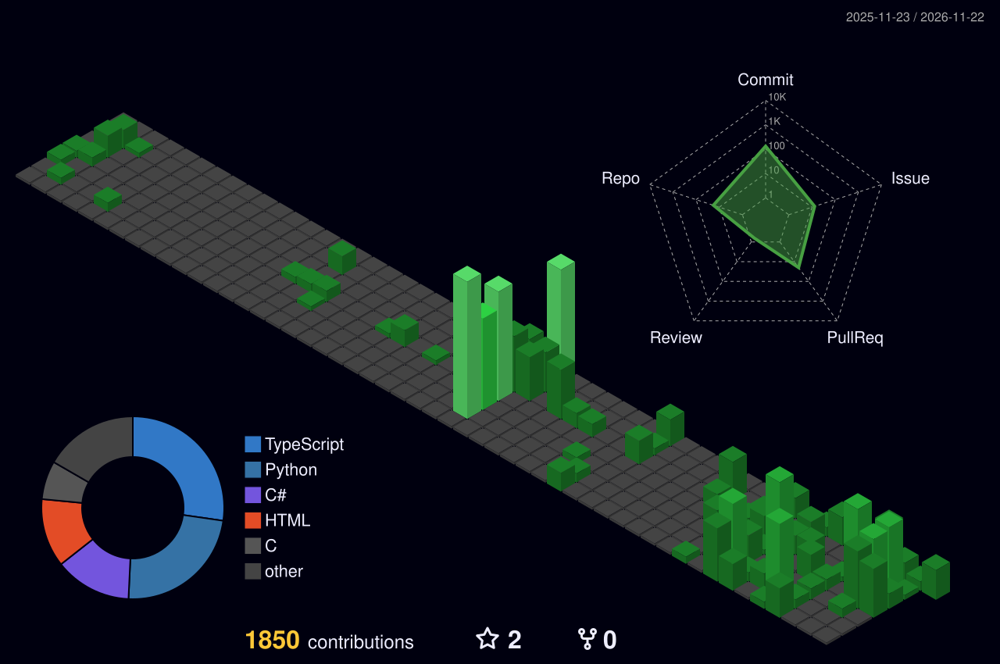

<h1 align="center">Igor Paslauski</h1>

  <strong>Desenvolvedor C# Sênior · Full Stack</strong> 
  ERP, sistemas fiscais e financeiros · Ijuí, RS, Brasil

  
  
  
  

---

## Sobre

Mais de 5 anos desenvolvendo e mantendo sistemas de gestão (ERP) com foco em **obrigações fiscais e financeiras**. Atuo de ponta a ponta: modelagem e otimização de banco de dados, APIs, integrações e interfaces web, além da modernização de sistemas legados.

## Áreas de atuação

| Área | O que entrego |
| --- | --- |
| **Obrigações acessórias** | Reinf, SPED, GIA, DIRF, DCTF e PAD, com integrações SOAP/REST e entrega dentro do prazo |
| **Performance** | Rotinas que levavam horas reduzidas a minutos (ex.: movimentação de estoque entre filiais, de ~2 h para ~3 min) |
| **Banco de dados** | Otimização de consultas e integração entre bases PostgreSQL, SQL Server, Sybase e Firebird |
| **Modernização** | Migração de Angular 6 para 15, Java EE/EJB, ExtJS e C#/.NET, mantendo o sistema em produção |

## Tecnologias

**Back-end** &nbsp;

**Front-end** &nbsp;

**Bancos de dados** &nbsp;

**Infraestrutura e observabilidade** &nbsp;

## GitHub

  
  

  

## Contato

Aberto a conversar sobre oportunidades e projetos. O caminho mais rápido é pelo [LinkedIn](https://www.linkedin.com/in/igor-paslauski-de-oliveira) ou por [e-mail](mailto:igor.paslauski123@gmail.com).
