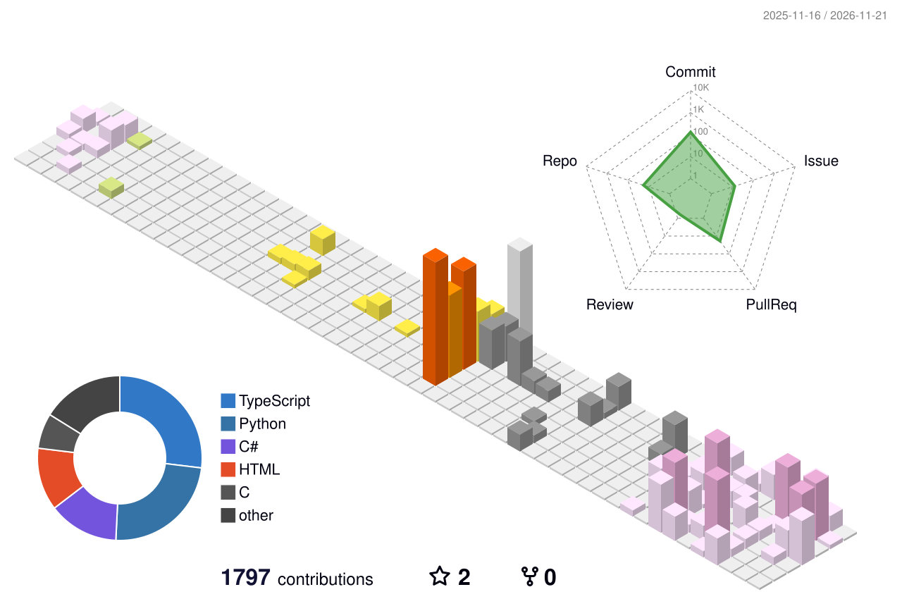

 

---

## 👋 Quem sou eu

Mais de **5 anos** em ERP, com foco em **obrigações fiscais e financeiras**. Gosto de pegar o problema que ninguém quer (a consulta que trava, a rotina que leva horas, o sistema legado que não pode parar) e deixar rápido, estável e fácil de manter. Trabalho de ponta a ponta: banco de dados, APIs, integrações e telas.

## 🔭 Atualmente

- 🎓 Finalizando o TCC na UNIJUÍ, sobre migração semiautomática de monolitos .NET para monolitos modulares
- 🥤 Evoluindo o [PuroSuco](https://github.com/IgorPaslauski/purosuco), minha linguagem de programação experimental
- 🧾 Dia a dia: sistemas fiscais e financeiros em C#, SQL e Angular

## 🧰 O que eu resolvo

| | Área | O que entrego |
| :-: | --- | --- |
| 🧾 | **Obrigações acessórias** | Reinf, SPED, GIA, DIRF, DCTF e PAD, com integrações SOAP/REST e entrega no prazo |
| ⚡ | **Performance** | Rotinas de horas viram minutos (ex.: estoque entre filiais, de ~2 h para ~3 min) |
| 🗄️ | **Banco de dados** | SQL otimizado e integração entre PostgreSQL, SQL Server, Sybase e Firebird |
| 🔧 | **Modernização** | Angular 6 → 15, Java EE/EJB, ExtJS e C#/.NET, sem derrubar a produção |

## 🚀 Projetos em destaque

| Projeto | Descrição | Stack |
| --- | --- | --- |
| [🥤 PuroSuco](https://github.com/IgorPaslauski/purosuco) | Linguagem de programação experimental com compilador próprio, gramática Tree-sitter e extensões de editor | C# · Tree-sitter |
| [🌱 ONG ASA](https://github.com/IgorPaslauski/ong-asa) | Landing page e painel administrativo do Instituto A.S.A. (Associação Semeando o Amanhã) | TypeScript |
| [🎨 LayoutPlus](https://github.com/IgorPaslauski/LayoutPlus) | Extensão que personaliza o layout do ChatGPT: largura da conversa, tipografia, blocos de código e tabelas | TypeScript |
| [🌐 Portfólio](https://github.com/IgorPaslauski/portifolioIgor) | Site pessoal em [paslauski.com.br](https://paslauski.com.br/) | TypeScript |

## 🛠️ Tecnologias

**Back-end** 

**Front-end** 

**Bancos de dados** 

**Infra e observabilidade** 

## 📊 GitHub em números

  
  

    

  

    

  

    

  <picture>
    <source media="(prefers-color-scheme: dark)" srcset="https://raw.githubusercontent.com/IgorPaslauski/IgorPaslauski/output/github-snake-dark.svg" />
    
  </picture>

## 📬 Vamos conversar?

Aberto a oportunidades e projetos bacanas. O caminho mais rápido é pelo [LinkedIn](https://www.linkedin.com/in/igor-paslauski-de-oliveira) ou por [e-mail](mailto:igor.paslauski123@gmail.com).

